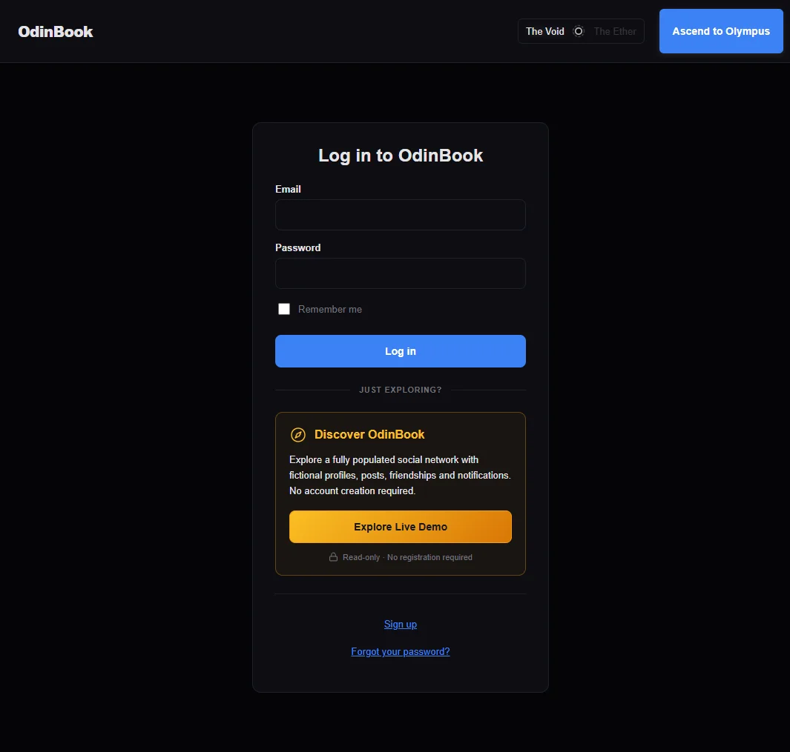
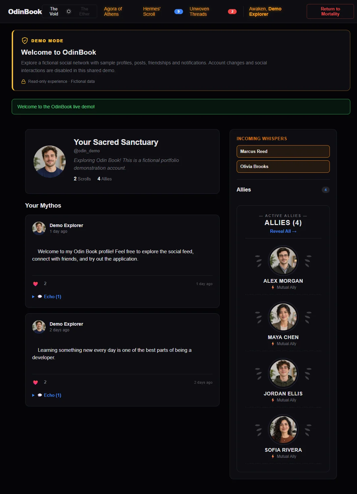
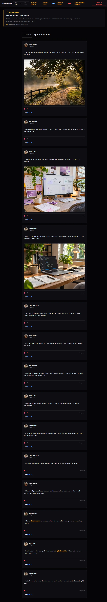
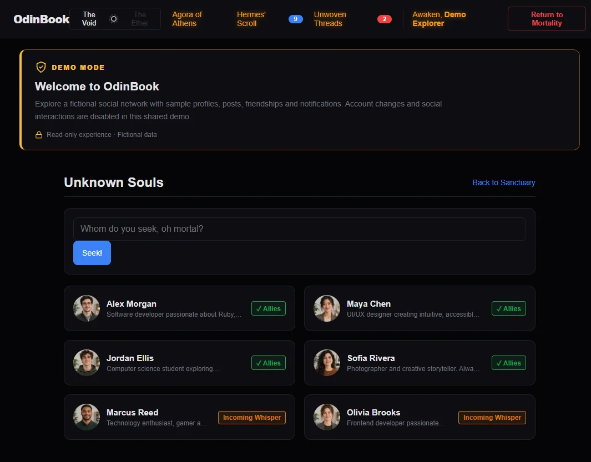
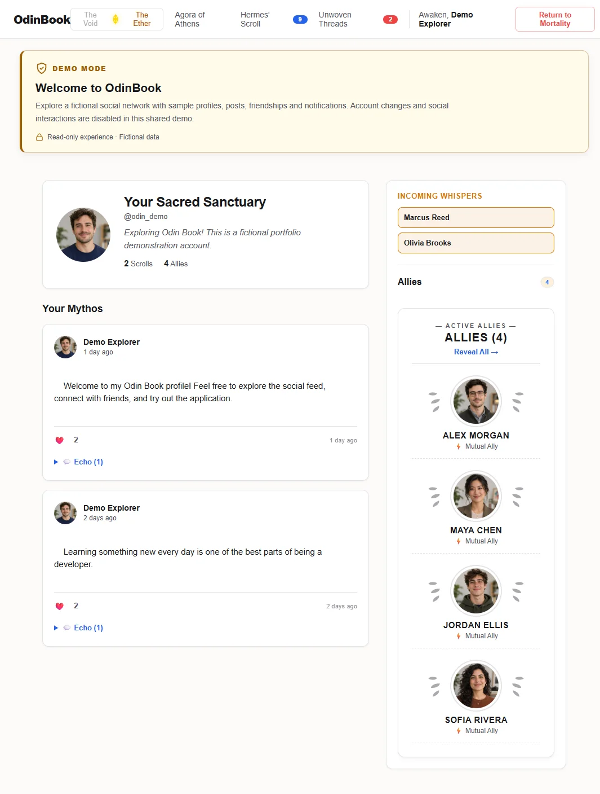
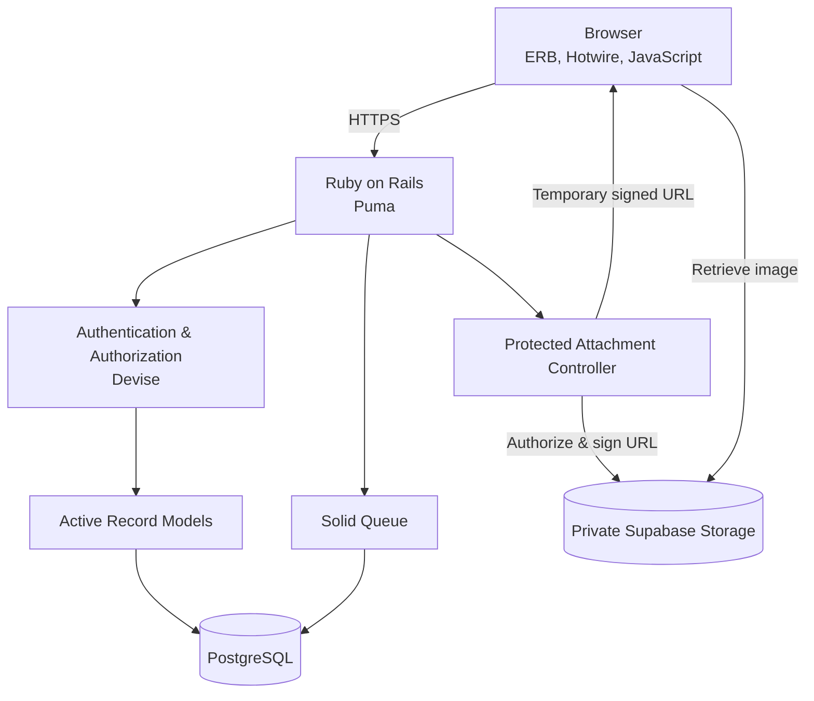
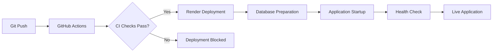

# OdinBook

A full-stack social networking application built with Ruby on Rails, featuring secure authentication, social interactions, private image storage, and an isolated, read-only live demo.

[](https://github.com/jameshsims91/odin-book/actions/workflows/ci.yml)


## Live Demo

**[Explore OdinBook](https://odinbook.jameshsims.tech/)**

Click **Explore Live Demo** on the login page to access a populated demonstration environment.

No registration, email address, or password is required.

The demo includes:

- 7 fictional user profiles
- 20 sample posts
- 40 post likes
- 20 comments
- 4 accepted friendships
- 2 pending friend requests
- Profile avatars and sample post images
- In-app notifications and user mentions
- Light and dark themes

The demonstration environment is read-only and isolated from regular user accounts. Visitors can explore the application without modifying shared demo content or accessing regular users' data.

All demo identities are fictional, and the sample images are AI-generated.


## Screenshots

### One-Click Recruiter Login

Explore the application without creating an account or entering credentials.



### Personalized Dashboard — The Void

Explore fictional profiles, sample posts, friendship requests, and social interactions within the isolated, read-only demonstration environment.



### Social Feed — Agora of Athens

Browse sample posts, image attachments, likes, comments, and user mentions.

<details>
<summary>View social feed screenshot</summary>



</details>

### User Discovery — Unknown Souls

Discover fictional users and view established friendships and pending friend requests.



### Light Theme — The Ether

Switch between light and dark themes with persistent user preferences.

<details>
<summary>View light theme screenshot</summary>



</details>


## About the Project

OdinBook is a social networking platform originally developed as the final Ruby on Rails project in [The Odin Project's Full Stack Ruby on Rails curriculum](https://www.theodinproject.com/lessons/ruby-on-rails-odin-book).

The project extends beyond the original curriculum requirements to include production deployment, authorization safeguards, private cloud storage, automated security scanning, continuous integration, and a recruiter-friendly demonstration environment.

The goal was to build and deploy a complete Rails application while gaining practical experience with full-stack development, relational database design, application security, automated testing, and cloud infrastructure.

## Features

### Authentication and Profiles

- User registration and authentication with Devise
- Session-based authentication
- Customizable user profiles
- Profile avatar uploads
- Username-based user discovery
- One-click demonstration login

### Social Networking

- Create, edit, and delete personal posts
- Image attachments
- Personalized social feeds
- Friend requests and friendship management
- Mutual friend discovery
- Post likes
- Comments and comment likes
- User mentions with autocomplete
- In-app notifications

### User Interface

- Responsive application layouts
- Hotwire-powered interactions
- Turbo Streams for dynamic updates
- Light and dark themes with persistent preferences
- Consistent profile navigation
- Dedicated read-only demonstration interface

### Image Management

- Active Storage attachment management
- Private S3-compatible object storage
- Image type and file size validation
- WebP image variants
- libvips image processing
- Authorized image delivery through short-lived signed URLs

## Technology Stack

| Category | Technology |
| --- | --- |
| Programming languages | Ruby, JavaScript, HTML, CSS |
| Backend | Ruby on Rails 8.1 |
| Ruby version | Ruby 3.4.13 |
| Frontend | ERB, Hotwire, Turbo, Stimulus |
| Database | PostgreSQL |
| ORM | Active Record |
| Authentication | Devise |
| Asset pipeline | Propshaft, Importmap |
| File attachments | Active Storage |
| Image processing | libvips |
| Object storage | Supabase Storage, S3-compatible API |
| Background jobs | Solid Queue |
| Caching | Solid Cache |
| Web server | Puma |
| Testing | Minitest, Capybara, Selenium |
| Code quality | RuboCop |
| Security scanning | Brakeman, Bundler Audit, Importmap Audit |
| CI/CD | GitHub Actions, Render |
| Hosting | Render |

## Application Architecture

OdinBook follows the Ruby on Rails Model-View-Controller architecture.



The application uses PostgreSQL for relational data and database-backed background jobs.

Image attachments are stored separately in private object storage. Authorized requests receive temporary signed URLs, allowing browsers to retrieve images directly from the storage service.

### Core Data Models

| Model | Responsibility |
| --- | --- |
| User | Authentication, account identity, and ownership |
| Profile | User profile information |
| Post | Published content and image attachments |
| Friendship | Friend requests and accepted relationships |
| Like | Post reactions |
| Comment | Discussions associated with posts |
| CommentLike | Comment reactions |
| Mention | Username-based references in posts |
| Notification | In-app social activity notifications |

## Security and Account Isolation

Security is enforced at the controller and model layers rather than relying exclusively on hidden interface controls.

### Demo Account Protection

The live demo uses a dedicated account flag to distinguish fictional demonstration accounts from regular accounts.

Protections include:

- Server-side restrictions on demo account write operations
- Account-scoped queries for users, profiles, posts, comments, and friendships
- Model-level validation against interactions between demo and regular accounts
- Protection against modification of demo account credentials
- Prevention of demo account deletion and password recovery
- Read-only presentation of posting, editing, and relationship controls
- Session reset during one-click demo authentication

These safeguards help maintain a consistent demonstration environment while protecting regular users' data.

### Application Security

Additional safeguards include:

- Devise authentication and password validation
- CSRF protection
- Ownership checks for protected resources
- Scoped authorization for nested resources
- Escaped user-generated content
- Safe DOM construction for mention autocomplete
- HTTPS enforcement in production
- Private attachment delivery
- Environment-managed production credentials
- Automated dependency and static security scanning
- Sensitive request parameter filtering
- Native Rails redirect log filtering for temporary signed storage URLs

### Private Attachment Delivery

Production images are stored in a private Supabase bucket.

1. An authenticated browser requests an image through a Rails attachment route.
2. The controller checks whether the requested resource is visible to the current account.
3. Rails generates a signed storage URL valid for 60 seconds.
4. The browser retrieves the image directly from object storage.

Default public-facing Active Storage routes are disabled in favor of application-controlled attachment endpoints.

Production redirect logs are sanitized using Rails' native redirect filtering configuration. Signed storage URLs, signature parameters, and credential identifiers are excluded from matching redirect log entries without modifying the actual redirect response sent to the browser.

This protection is covered by seven automated regression tests and has been verified against fresh production logs while confirming that authorized image delivery remains functional.

## Testing and Code Quality

OdinBook includes automated coverage for application functionality, authorization, demonstration account isolation, attachment access, and user interface behavior.

### Release Verification

The final production security and logging hardening release completed the following local verification:

| Test suite | Tests | Assertions |
| --- | ---: | ---: |
| Model and integration tests | 120 | 342 |
| Browser system tests | 2 | 6 |
| **Total** | **122** | **348** |

Release results:

- 0 test failures
- 0 test errors
- 0 skipped tests
- 127 files inspected by RuboCop with no offenses
- 0 Brakeman security warnings
- No known vulnerabilities reported by Bundler Audit
- No vulnerable packages reported by Importmap Audit
- All 5 GitHub Actions CI jobs passed
- All 7 redirect filtering regression tests passed
- All 15 attachment security tests passed
- All 44 checks in the final production acceptance round passed

Production verification included authentication, recruiter demo restrictions, account isolation, image delivery, signed URL logging protection, infrastructure stability, and portfolio integration.

**Final production verification:** November 2026.

### Run the Tests

```bash
bin/rails db:test:prepare
bin/rails test
bin/rails test:system
```

### Run Code Quality and Security Checks

```bash
bin/rubocop
bin/brakeman --no-pager
bin/bundler-audit
bin/importmap audit
```

The system test suite uses Selenium with headless Firefox.

## Continuous Integration and Deployment

GitHub Actions runs automated checks on pull requests and pushes to the main branch.

The CI pipeline contains five jobs:

| Job | Responsibility |
| --- | --- |
| scan_ruby | Brakeman and Bundler Audit |
| scan_js | JavaScript dependency auditing |
| lint | RuboCop code quality checks |
| test | Rails model and integration tests |
| system-test | Browser-based system tests |



Production deployments are configured to occur after successful CI checks.

## Production Infrastructure

OdinBook is deployed using a resource-conscious cloud architecture.

| Service | Responsibility |
| --- | --- |
| Render Web Service | Rails application hosting |
| Render PostgreSQL | Persistent relational data |
| Supabase Storage | Private image storage |
| GitHub Actions | Automated testing and security checks |
| Custom domain | HTTPS application access |

The deployment uses a single Rails web process with an asynchronous Solid Queue supervisor, limiting the need for additional persistent background worker services.

The production configuration includes:

- Puma single-process mode
- Limited web and background-job thread concurrency
- Database-backed job processing and caching
- Automated database preparation before deployment
- Health monitoring through `/up`
- HTTPS enforcement
- Private cloud object storage

These decisions allow the application to operate within a small hosting footprint.

## Local Development

### Prerequisites

- Ruby 3.4.13
- Bundler
- PostgreSQL
- libvips
- Git
- Firefox for browser system tests

### 1. Clone the Repository

```bash
git clone https://github.com/jameshsims91/odin-book.git
cd odin-book
```

### 2. Install System Dependencies

For Ubuntu or WSL Ubuntu:

```bash
sudo apt update
sudo apt install build-essential libpq-dev postgresql libvips
```

Ensure PostgreSQL is running:

```bash
sudo service postgresql start
```

Your local PostgreSQL account must have permission to create the development and test databases.

### 3. Install Dependencies and Prepare the Database

```bash
bundle install
bin/rails db:prepare
```

Alternatively, use the included setup script:

```bash
bin/setup --skip-server
```

Local development uses disk-based attachment storage. Supabase credentials are not required for the local development environment.

### 4. Populate the Optional Demo Environment

The repository includes dedicated scripts for creating fictional users, social content, and image attachments.

From Bash, enter a strong local demonstration password without displaying it in the terminal:

```bash
read -rsp "Local demo password: " DEMO_PASSWORD
echo
export DEMO_PASSWORD
```

Run the unified setup script:

```bash
RAILS_ENV=development bin/rails runner db/demo_setup.rb
unset DEMO_PASSWORD
```

The setup script creates demonstration accounts, friendships, posts, comments, likes, and image attachments.

It is designed to reuse existing demonstration records and skip previously attached images when rerun.

The demo setup scripts are restricted to development unless production execution is explicitly authorized. They are not permitted in the test environment.

### 5. Start the Application

```bash
bin/dev
```

Open:

[http://localhost:3000](http://localhost:3000)

Select **Explore Live Demo** if the optional demonstration dataset has been created.

## Production Configuration

Production credentials are supplied through environment variables rather than committed to the repository.

Required production configuration includes:

| Variable | Purpose |
| --- | --- |
| RAILS_ENV | Rails environment |
| RAILS_MASTER_KEY | Encrypted Rails credentials |
| DATABASE_URL | PostgreSQL connection |
| APP_HOST | Production application hostname |
| STORAGE_ACCESS_KEY_ID | Object storage access key |
| STORAGE_SECRET_ACCESS_KEY | Object storage secret |
| STORAGE_ENDPOINT | S3-compatible storage endpoint |
| STORAGE_REGION | Storage region |
| STORAGE_BUCKET | Private storage bucket |

Additional environment variables control database connections, Puma concurrency, logging, and background job processing.

### Render Commands

Build:

```bash
bundle install && bundle exec rails assets:precompile
```

Pre-deploy:

```bash
bin/rails db:prepare
```

Start:

```bash
bundle exec puma -C config/puma.rb
```

Health check:

```text
/up
```

Production demonstration seeding is an explicitly authorized maintenance operation, not part of the normal deployment process.

Never commit production passwords, master keys, database credentials, or storage credentials.

## Project Structure

```text
odin-book/
├── app/
│   ├── assets/
│   ├── controllers/
│   │   └── concerns/
│   ├── helpers/
│   ├── javascript/
│   ├── models/
│   │   └── concerns/
│   └── views/
├── config/
├── db/
│   ├── demo_assets/
│   │   ├── avatars/
│   │   └── posts/
│   ├── migrate/
│   ├── demo_seeds.rb
│   ├── demo_content.rb
│   ├── demo_images.rb
│   └── demo_setup.rb
├── test/
│   ├── fixtures/
│   ├── integration/
│   ├── models/
│   └── system/
├── .github/
│   └── workflows/
│       └── ci.yml
├── Gemfile
└── README.md
```

## Engineering Challenges and Lessons Learned

### Building a Safe Public Demonstration

A public demonstration account introduces different requirements from ordinary user authentication.

I implemented account-scoped queries, model-level interaction validation, credential protection, and server-side write restrictions to allow visitors to explore the application without changing demonstration content or accessing regular accounts.

### Protecting Uploaded Images

Using private object storage required more than uploading files to a cloud service.

I implemented authorized attachment endpoints and short-lived signed URLs to preserve application-level visibility rules while allowing direct image retrieval from object storage.

### Deploying Within Resource Constraints

The application initially encountered memory limitations when background jobs ran in separate processes.

I configured Puma and Solid Queue to use a single-process architecture with controlled concurrency, allowing the application to run on a small production instance without a dedicated background worker service.

### Establishing a Reliable Release Process

I implemented a release workflow that combines automated tests, static security analysis, dependency scanning, database migrations, and manual production verification.

The demonstration environment was deployed in two stages: security infrastructure first, followed by the fictional dataset. This reduced the risk of exposing demonstration records before isolation protections were active.

### Preventing Sensitive Information from Appearing in Logs

Production verification revealed that temporary signed object storage URLs were appearing in application redirect logs.

I investigated Rails' redirect instrumentation and implemented native redirect URL filtering to prevent signatures and storage credential identifiers from appearing in matching log entries.

I added seven automated regression tests to verify that sensitive redirect locations are filtered, ordinary redirects remain visible, and the original browser response is preserved.

Following deployment, I verified the filtering behavior against fresh production logs while confirming that avatars and post images continued loading correctly.

This reinforced the importance of validating security controls in the live production environment rather than relying exclusively on local automated tests.

## Current Limitations and Future Improvements

OdinBook is a completed portfolio application rather than a commercial social networking service.

The application has successfully completed production deployment, security hardening, automated release testing, and live production acceptance testing.

Potential future improvements include:

- Production email delivery and email-based password recovery
- Optional third-party OAuth authentication
- Browser push notifications
- Database query optimization and performance profiling
- Additional accessibility testing
- Expanded automated test coverage
- Ongoing dependency maintenance and security monitoring

In-app notifications remain available in the deployed application.

The current release is considered feature-complete for its intended portfolio and demonstration purposes.

## Author

Developed by James Sims as part of an ongoing journey in full-stack software development.

- **Portfolio:** [jameshsims.tech](https://jameshsims.tech/)
- **GitHub:** [github.com/jameshsims91](https://github.com/jameshsims91)
- **Live Project:** [odinbook.jameshsims.tech](https://odinbook.jameshsims.tech/)

## Acknowledgments

- [The Odin Project](https://www.theodinproject.com/) — Full Stack Ruby on Rails curriculum
- [Ruby on Rails](https://rubyonrails.org/)
- [Hotwire](https://hotwired.dev/)
- [Devise](https://github.com/heartcombo/devise)
- [Render](https://render.com/)
- [Supabase](https://supabase.com/)
